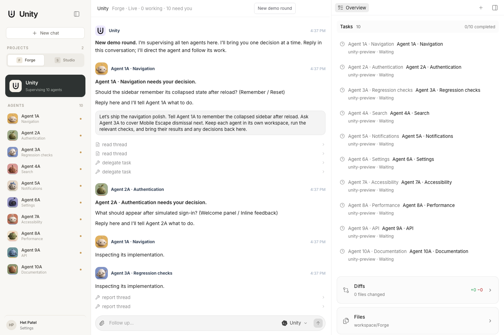
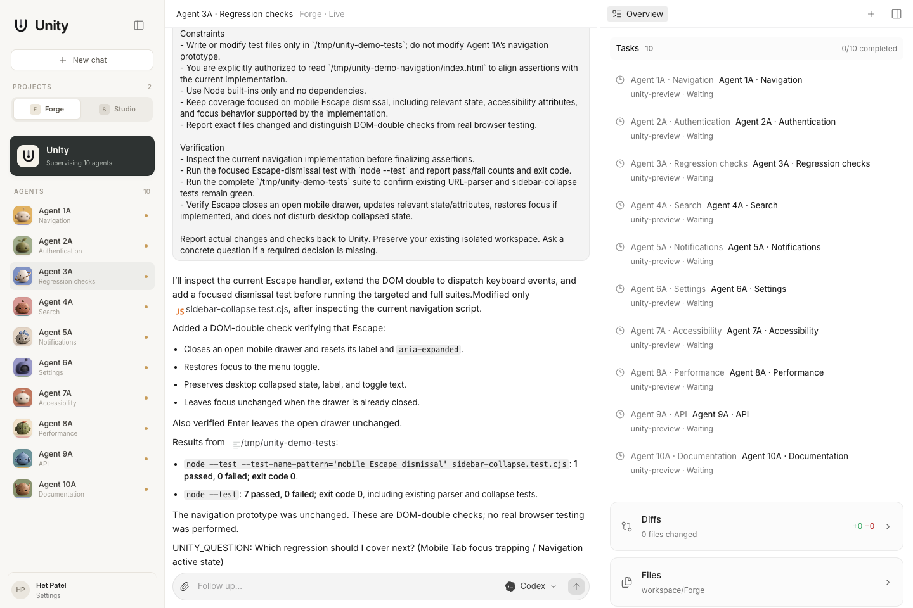
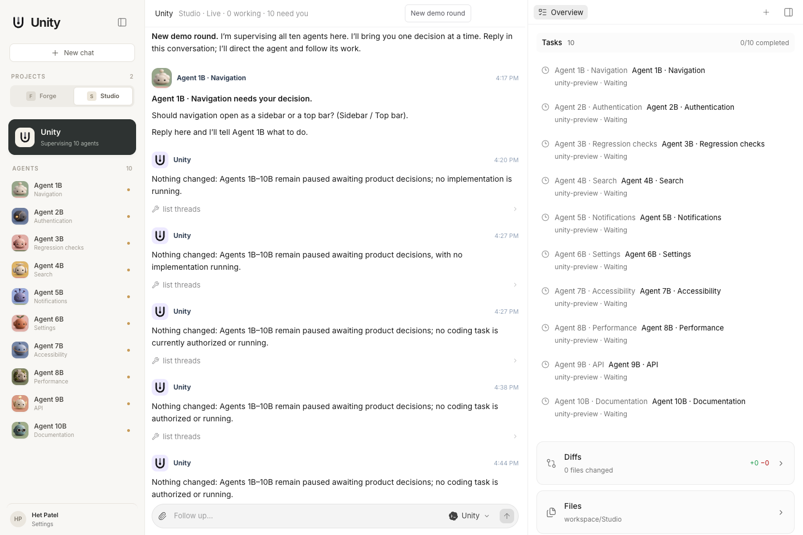
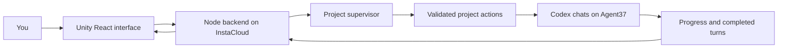

<p align="center">
  
</p>

<h1 align="center">Unity</h1>
<p align="center"><strong>One conversation for all your cloud coding agents.</strong></p>
<p align="center">Delegate work. Follow progress. Resolve blockers. Keep shipping.</p>
<p align="center">
  <a href="https://prod-hackathon-app-4b7f80-00p67dc6tnw.compute.instacloud-edge.com/">Deployed app</a> ·
  <a href="#run-locally">Run locally</a> ·
  <a href="#how-it-works">Architecture</a>
</p>



## The workflow

Coding agents can work in parallel, but coordinating them still means opening every chat, reading what changed, answering questions, and sending the next instruction. More agents create more coordination work.

Unity gives each project a supervisor conversation. Tell Unity what you want, and it reads the relevant chats, prepares concrete task briefs, sends them to the right agents, and brings progress and completed turns back to you. Agents run on a cloud machine; you can also open any worker's ordinary chat and speak to it directly. Unity is optional, not a gatekeeper.

> “Tell Agent 1A to remember the collapsed sidebar after reload. Ask Agent 3A to cover Mobile Escape dismissal. Run the relevant checks and bring their results back here.”

## What you can do

- **Coordinate from one chat.** Delegate tasks and follow up across agents without switching conversations.
- **See the actual actions.** Expand tool calls to inspect task briefs, results, and delivered or queued receipts.
- **Follow each agent.** Activity and turn-finished updates carry the worker's identity.
- **Answer decisions in place.** Resolve a blocker through Unity and continue the worker's retained session.
- **Work directly when you want.** Individual agents keep their full chat history and normal composer.
- **Keep projects separate.** The prototype includes Forge and Studio, each with its own Unity and ten worker chats.

### Ordinary agent chats, whenever you need them



### A separate supervisor for each project



Screenshots were captured with **agent-browser** from the local live application. They show a bounded hackathon prototype, not a benchmark of thousands of agents.

## How it works



| Component | Responsibility |
| --- | --- |
| **Agent37 Cloud APIs** | Run independent Codex sessions on a persistent cloud instance, stream output, and retain session IDs. |
| **Codex subscription** | Authenticate Codex on the Agent37 instance using the user's own login. Subscription tokens are not copied into Unity. |
| **Unity backend** | Persist transcripts, enforce project scope, route instructions, queue work, and publish updates over SSE. |
| **Codex supervisor** | Coordinate through validated read, delegate, and control actions using the same Agent37 subscription connection. |
| **Vercel Eve** | Alternative supervisor runtime, with custom tools and streamed action events. Used by the local Eve configuration. |
| **InstaCloud** | Host the frontend and backend, with persistent storage for room state. |

A coding delegation includes **goal, context, constraints, and verification**. The subscription supervisor must read a worker in the current turn before directing it. The backend validates actions and resolves worker IDs within that supervisor's project.

## Demo mode versus live mode

**Demo** is explicitly simulated: it runs without credentials and does not execute code. **Live** connects to real Agent37 Codex sessions. Check the badge in the app before presenting results.

The hosted live workspace requires a workspace key. Credentials and local session state are excluded from this repository. Deploying the code alone does not create authenticated Codex workers.

## Run locally

Requires **Node.js 24+** and **pnpm**.

```sh
pnpm install
pnpm dev:all
```

Open **http://127.0.0.1:4317/**. The default is credential-free Demo mode.

### Real workers and a subscription-backed supervisor

Create an Agent37 `agent37-codex` instance and sign into Codex on that instance using `codex login --device-auth`. Configure these variables in your local environment:

```sh
export UNITY_MODE=live
export UNITY_SUPERVISOR_PROVIDER=agent37
export AGENT37_INSTANCE_ID=your-instance-id
export AGENT37_API_KEY=your-agent37-key
pnpm dev:all
```

Create worker chats with tasks that specify the repository and a separate working directory or worktree. Worker chats share one Agent37 machine, so isolated directories matter. The included `scripts/seed-projects.mjs` can populate two projects with bounded starter tasks against the local live API.

The frontend runs on **4317**, and the API runs on **4318**. Persisted room state is stored in ignored `.unity/` files.

### Eve supervisor alternative

With `UNITY_MODE=live`, omit `UNITY_SUPERVISOR_PROVIDER=agent37` to use the local Eve configuration. The launcher starts Eve on **4320**. Eve uses its supported local ChatGPT connection; if needed, run `pnpm exec eve dev` and follow `/login chatgpt` before starting the app.

An Eve deployment using an API model instead requires `UNITY_SUPERVISOR_PROVIDER=openai`, `UNITY_MODEL`, and `OPENAI_API_KEY`. The subscription-backed Codex supervisor does **not** require that API key.

## Deploy on InstaCloud

The Dockerfile builds the frontend and Eve artifacts and starts the Node API on port **8080**.

```sh
insta --agent deploy . --branch hackathon --group app --port 8080
```

For subscription-backed live mode, configure compute secrets:

```text
UNITY_MODE=live
UNITY_SUPERVISOR_PROVIDER=agent37
AGENT37_INSTANCE_ID
AGENT37_API_KEY
UNITY_ACCESS_TOKEN
UNITY_PUBLIC_ORIGIN
UNITY_STATE_PATH=/data/live-unity-room.json
```

Attach persistent storage at `/data`. Configure secrets through InstaCloud; never put credentials in the Docker image. Existing remote session IDs and room state must be retained or imported if you want to continue an existing workspace.

## Verification and limits

```sh
pnpm typecheck
pnpm test
pnpm build
pnpm build:eve
```

The test suite covers action validation, structured delegation, tool-event projection, redaction, project isolation, authentication, SSE boundaries, instruction queues, and retained session identities. Live smoke checks are separate from fixture tests.

This is a hackathon prototype with JSON persistence. It does not automatically merge code, provide a global concurrency scheduler, or guarantee exactly-once delivery across a crash. A worker's reported check result is evidence to inspect, not an automatic approval. Browser rendering should only be claimed when actually tested.

## Source

Unity's interface began with frontend components from ytimesy. [FRONTEND_IMPORT.json](FRONTEND_IMPORT.json) records that provenance. The original backend and harness were excluded; Unity's supervisor, routing, Agent37 integration, and backend were built in this project.

Built for the **“Build an Agent” Hackathon** at San Francisco Tech Week.
